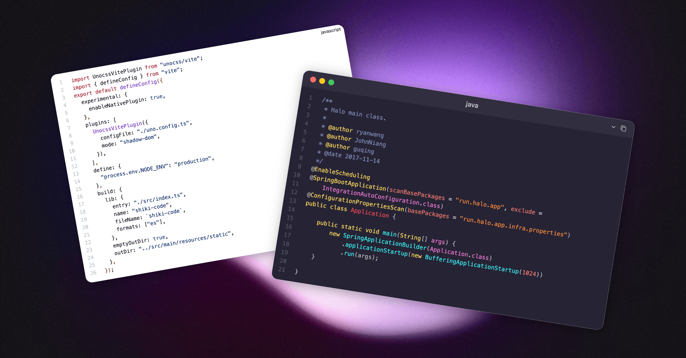

# Shiki 代码高亮

适用于 Halo 的 [Shiki](https://shiki.style/) 代码高亮插件，为文章等内容的代码块提供高亮渲染支持。



## 特性

- 支持 200+ 种编程语言的代码高亮，详见：[Languages | Shiki](https://shiki.style/languages)
- 支持 60 个代码高亮风格，详见：[Themes | Shiki](https://shiki.style/themes)
- 支持两种 UI 风格（简单 / Mac 窗口）
- 无需主题主动适配，在不同主题之间表现一致
- 支持为 Halo 编辑器设置代码块高亮风格
- 支持为非文章页面启用代码高亮渲染，如瞬间、Docsme 文档页面等
- 体积轻量，支持异步加载语言和高亮风格依赖
- 支持分别为暗色和亮色模式设置代码高亮风格
- 支持代码行高亮、行聚焦、代码对比、代码折叠

## 安装

1. 下载，目前提供以下两个下载方式：
    - GitHub Releases：访问 [Releases](https://github.com/halo-sigs/plugin-shiki/releases) 下载 Assets 中的 JAR 文件
    - Halo 应用市场：https://www.halo.run/store/apps/app-kzloktzn
2. 安装，插件安装和更新方式可参考：https://docs.halo.run/user-guide/plugins

## 使用方式

### 个性化设置

安装完成之后，不需要特别的设置即可开始使用，默认会在文章和页面内容自动渲染，以下是一些额外的个性化设置说明：

在阅读下面的内容之前，可以先进入插件设置页面。

1. 基本设置
   1. 启用主题侧渲染： 关闭之后将不会在网站前台执行代码高亮渲染，适用于主题已经提供了代码高亮渲染的场景。
   2. 额外渲染规则：如果你想渲染其他页面中的代码块，可以在这里设置路径规则。
   3. 排除语言：排除指定语言的代码块不进行 Shiki 高亮渲染，适用于需要其他插件处理的特定语言（如 mermaid、plantuml 等）。排除的代码块将保留原始的 pre>code 结构，不被 shiki-code 元素包裹，便于其他 JavaScript 库或插件进行处理。
   4. 风格：可选简单和 Mac 窗口，未来会提供更多 UI 风格。
   5. 亮色主题：在主题的亮色模式下的代码高亮风格。
   6. 暗色主题：在主题的暗色模式下的代码高亮风格，非必填，如果不填写则使用亮色主题。
2. 编辑器设置
   1. 高亮主题：为 Halo 编辑器设置代码高亮风格。

### 代码行标记语法

插件内建了 Shiki 的一些[代码转换器](https://shiki.style/packages/transformers)，包括行高亮、行聚焦、代码对比和代码折叠。这些功能均通过在代码块中添加特定标记实现。

#### 基本写法

标记需要写在对应语言的注释中。不同语言的注释语法不同，请根据代码块使用的语言选择合适的注释风格。

常用标记如下：

| 功能 | 标记 | 说明 |
| ---- | ---- | ---- |
| 行高亮 | `[!code highlight]` 或 `[!code hl]` | 高亮后续一行 |
| 行高亮 | `[!code highlight:n]` | 高亮后续 n 行 |
| 警告行 | `[!code warning]` | 为后续一行添加警告样式 |
| 错误行 | `[!code error]` | 为后续一行添加错误样式 |
| 行聚焦 | `[!code focus]` | 聚焦后续一行 |
| 行聚焦 | `[!code focus:n]` | 聚焦后续 n 行 |
| 代码对比 | `[!code --]` | 将后续一行标记为删除内容 |
| 代码对比 | `[!code ++]` | 将后续一行标记为新增内容 |
| 代码对比 | `[!code --:n]` / `[!code ++:n]` | 将后续 n 行标记为删除或新增内容 |
| 代码折叠 | `[!code fold:start]` | 标记折叠区域的起始位置 |
| 代码折叠 | `[!code fold:end]` | 标记折叠区域的结束位置 |

以上标记均应放在对应语言的注释中。例如，JavaScript 中的行高亮标记写作 `// [!code highlight]`，Python 中则写作 `# [!code highlight]`。

标记本身用于控制渲染效果，渲染后会自动移除，不会作为普通代码内容显示。

#### 常用语言的注释写法

下表以代码折叠的起始标记为例，列出了常见语言对应的注释写法。其他功能只需将示例中的 `[!code fold:start]` 替换为相应标记即可。

| 语言 | 注释风格 | 写法示例 |
| ---- | ---- | ---- |
| JavaScript / TypeScript / Java / C / C++ / C# / Go / Rust / PHP / Swift / Kotlin / Dart / Scala | `//` | `// [!code fold:start]` |
| Python / Ruby / Shell（Bash）/ YAML / TOML / R / Perl / PowerShell / Dockerfile / Makefile / Nginx 配置 | `#` | `# [!code fold:start]` |
| HTML / XML / Markdown | `<!-- -->` | `<!-- [!code fold:start] -->` |
| CSS / SCSS / Less | `/* */` | `/* [!code fold:start] */` |
| SQL / Lua / Haskell | `--` | `-- [!code fold:start]` |
| LaTeX / MATLAB / Erlang | `%` | `% [!code fold:start]` |
| Lisp / Clojure / INI / 汇编 | `;` | `; [!code fold:start]` |
| Vim Script | `"` | `" [!code fold:start]` |

#### 使用示例

以下示例均使用 JavaScript 的 `//` 注释语法。使用其他语言时，请将标记替换为该语言对应的注释写法。

**1. 行高亮**

```ts
console.log('Not highlighted')
// [!code highlight]
console.log('Highlighted')
// [!code highlight:2]
console.log('Highlighted')
console.log('Highlighted')
```

**2. 行聚焦**

```ts
console.log('Not focused')
// [!code focus]
console.log('Focused')
// [!code focus:2]
console.log('Focused')
console.log('Focused')
```

**3. 代码对比**

```ts
// [!code --]
console.log('hewwo')
// [!code ++]
console.log('hello')
// [!code ++:2]
console.log('goodbye')
console.log('welcome')
```

**4. 代码折叠**

使用成对的起始和结束标记，可以折叠指定范围内的代码。点击起始行上的折叠提示即可展开或收起。

```ts
console.log('Visible')
// [!code fold:start]
function hidden() {
  return 'Folded'
}
// [!code fold:end]
console.log('Visible')
```

如果省略结束标记，则从起始标记处折叠至代码块末尾，并在代码块底部显示展开按钮。

```ts
console.log('Visible')
// [!code fold:start]
console.log('Folded to the end')
console.log('Folded to the end')
```

#### 注意事项

- 请根据代码块的实际语言选择正确的注释语法，避免标记被当作普通文本处理。
- 带有 `:n` 的标记用于指定连续作用的行数，其中 `n` 为行数。
- 代码折叠的起始和结束标记应成对使用；省略结束标记时，折叠范围默认延伸至代码块末尾。
- 标记是渲染控制指令，渲染后会自动移除。

## 注意事项

1. [highlight.js 代码高亮](https://github.com/halo-sigs/plugin-highlightjs) 和此插件均为 Halo 官方维护，但目前更加推荐使用此插件，highlight.js 插件将在未来进入维护状态（仅修复问题，不再添加新功能）。
2. 安装此插件之后，建议卸载其他代码高亮插件，以及关闭主题的代码高亮渲染功能（如有）。
3. 与 highlight.js 不同的是，Shiki 不支持将代码块语言设置为 `auto`。在使用此插件时，需要正确设置语言，否则可能无法渲染。
4. 此插件已经尽可能在多个主题中测试兼容性，但无法保证完全兼容，特别是当主题自行实现了代码高亮功能时。如果遇到兼容性问题，建议先尝试关闭主题的代码高亮功能，或者向主题反馈兼容问题。
5. 部分主题使用了 Pjax，经测试在文章页面可以完全兼容。但如果你设置了其他页面的渲染规则，可能在切换页面后代码高亮无法正常渲染，建议考虑关闭 Pjax 功能。
6. 插件支持为主题的暗色和亮色模式设置不同的代码高亮风格，并且尽可能为不同主题的配色切换方案做了适配，但如果你使用的主题不兼容，可能需要向主题反馈兼容问题。

## 主题适配

### 暗色/亮色模式切换

插件支持分别为暗色和亮色模式设置代码高亮风格，但仍然需要主题提供适配，适配方案：

1. 默认情况下，会使用亮色模式渲染代码块。
2. 如果需要在主题的暗黑模式下让代码块使用暗色模式，需要：
   - 在 html / body 标签中添加 `class="dark"` 或者 `class="color-scheme-dark"`
   - 或者在 html / body 标签中添加 `data-color-scheme="dark"`
3. 如果你的主题支持根据操作系统自动切换模式，需要：
   - 在 html / body 标签中添加 `class="color-scheme-auto"`
   - 或者在 html / body 标签中添加 `data-color-scheme="auto"`

如果你的主题已经满足上面的要求，可以不做任何改动。

## 作为 NPM 库使用

除了为 Halo 提供开箱即用的代码高亮支持，此仓库还将核心的 Shiki 高亮组件发布到了 npm，详见：<https://www.npmjs.com/package/@halo-dev/shiki-code-element>
